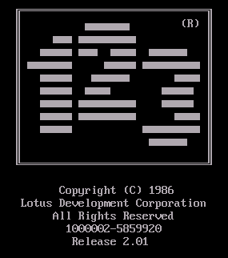
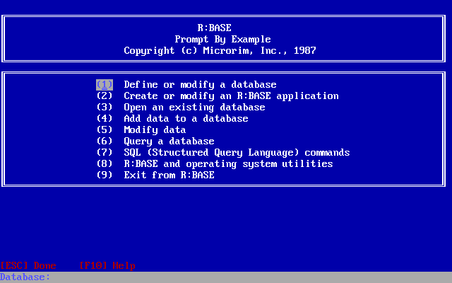
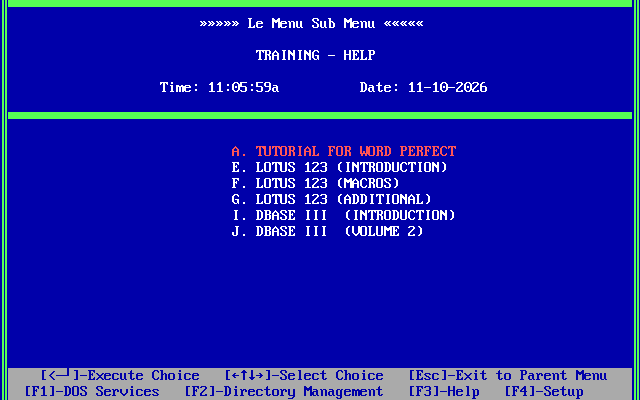
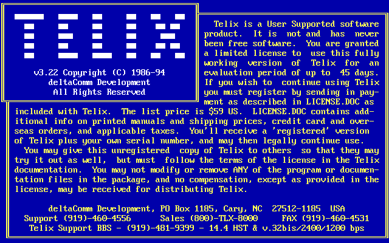
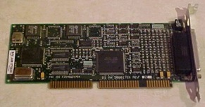
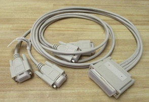
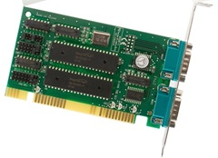

### Why this post?

Once the PCs were networked, there came the desire to build and use software to take advantage of them.

While the majority of people only used the network for file and print sharing and for mainframe access, some groups had more collaborative ideas.

### TL;DR

We didn't just do harware - software was part of the picture as well.

<!--more-->

### Disclaimer

Same disclaimer as before - I can't list these in any specific order.

### Lotus 1-2-3 "bridge"

One of the first PC-based programming projects I remember being involved with was the creation of a specific file-format conversion process. 

The actuarial department used proprietary software for performing certain modeling projects. They would run multiple iterations of this software making minor changes to key parameters for each test. However, changing these parameters required the user to use the software's menu system to make these changes.

<figure style="float:right; margin:5px; padding:3px; border:2px solid black;" >

</figure>
They wanted a tool that would let them build these various settings in Lotus 1-2-3, export that to a text (csv?) file, and run something that would create the settings files for the software to use. 

The idea was to be able to set up "X" number of tests and let them run without manual intervention. (e.g. Start them on a Friday afternoon and let the PC work on them all weekend.)

The proprietary software provided sufficient documentation for how to programmaticaly alter the data files, and to trigger a run. But I knew it wasn't practical to expect me to learn enough quickly enough to write this myself.

We hired a contractor to do the bulk of the work. My role primarily was to serve as the interface between the actuarial department and the contractor.

Things progressed rather smoothly - the program was written and tested successfully. However, when the first large-scale test was run, it ran out of memory.

Debugging revealed a memory leak in the proprietary program's library for allocating variables. Fixing it directly would have involved adding a lot of internal housekeeping to our program. I came up with a "brute-force, smash it with a brick" solution - find the beginning of the data blocks allocated by the library and reinitialize the entire block. This discarded all the individual blocks while maintaining all the internal data being used by the program. Surprisingly enough (to me) this actually worked quite well.

### PRISM

The big project for us at this time was the deployment of PCs and networks in our field offices.

Those offices didn't have a reasonable way to get current information for customers. If a customer had a question, they generally had to call into the home office to get answers.

Our management had the vision to create a suite of applications that put the most important data out in the field, where the office staff could access it. There was also the ability to make some administrative changes, and submit them back to the home office.

<figure style="float:left; margin:5px; padding:3px; border:2px solid black;" >

</figure>

After a fairly extensive evaluation, the software used for creating the applications was R:Base. It had a number of features, both technical and administrative, that made it better for us than any of the other database programming environments available at the time. 

Most notably, it used SQL as its query language, was designed for multi-user network usage, could be scripted for batch-style operations, and offered a distributable runtime license.

<figure style="float:right; margin:5px; padding:3px; border:2px solid black;" >

</figure>
We selected LeMenu as the DOS menuing product for managing access to the applications. The staff would not need to memorize or enter DOS command-line commands. Everything they needed to do could be accessed through the menus. It featured a menu entry-level security system. Any individual menu entry could be password protected. A password was also needed to exit.

I was involved in the decision process for both of these products, but not involved in the development.

#### Remote data synchronization

I was tasked with the processes of getting the data out to the field and bringing it back.

Remember, this is the 1989 - 1991 time frame. There was no generally-available commercial internet. Networking in a business generally meant Novell NetWare, or smaller peer-to-peer networks. Connectivity was dial-up - and was strictly point-to-point. 

Dedicated circuits for persistent connectivity were available, but prohibitively expensive. Connecting each office to the home office with a low-speed digital link (9600 bits/second) was going to average more than $1000 / month. That's per-office, not total. Connecting 50 offices would have been more than $80,000 per month, approaching $1,000,000 per year. ($1M in 1988 would be more than $2.5M today.)

Dial-up it was. After an appropriate search, I selected Telix as the telecommunication package, primarily due to the quality of its embedded scripting language, Salt.

<figure style="float:left; margin:5px; padding:3px; border:2px solid black;" >

</figure>

We decided that we would have a bank of PCs in the home office with modems. They would be in the main computer room with the mainframe, for the operators to manage.

Out in the field, before closing, the administrators would be responsible for putting the primary PC into "Nightly mode". This mode ran a script to create a zip file from the data entered into the field, dial into the home office, send the file, disconnect, then run the script to listen for an incoming call.

On the home office side, when a call came in, the local script would receive the file. It would then unzip it, and upload the data to the mainframe to be processed during the nightly cycle.

When it was time to start the nightly cycle, the PCs were taken out of "receive mode".

After cycle, the operators would run a process on one of the PCs to download the updates, split those files into bundles to go to the appropriate offices, create zip files, then start the dialing processes. This "split and package" process also created a control file for each office to track the status of the transmission to that office.

The operators would then start the dialing process on all the PCs. Each PC would then "checkout" one of the offices, dial out to that office, send the updated data, identify the transmission as complete, and disconnect.

Something I learned about NetWare at this point was that file locks did not extend beyond the life of the process acquiring a lock. In other words if a process locked a file, and then exited, the lock would be released. Handling this across processes in things like batch files was difficult and error prone. 

The solution I adopted was the use of lock files. It was easier to create a lock on a directory, create a file, then release the lock. If another process tried to create the same file, it couldn't do that while the lock was held, and if there was no lock, trying to create a file that already existed would throw an error.

In this manner, the PCs could grab an available office and do its transmission.

The operators would periodically check on things to verify that everything was running.

After receiving the data in the field office, the script would unzip the files, run the R:Base scripts to update the local database, and return control to LeMenu for normal daytime operations.

It wasn't slick, and for sure it wasn't pretty. But it was as robust as I could make it, with multiple layers of internal checks. There were also multiple layers of hooks created to where I could update the scripts out in the field. 

It was generally fatal to change a DOS batch file, Salt script, or R:Base program while they were running. So the batch files and Salt scripts would exit at appropriate times to other batch files or scripts so that those original files could be updated. We even had a mechanism to update the menus in LeMenu.

If we ever had a situation that couldn't be fixed through our scripts, we also had PCAnywhere installed for our Help Desk to use.
<figure style="float:right; margin:5px; padding:3px; border:2px solid black;" >

<figcaption>One version of the 4-port Digiboard card</figcaption>
</figure>

In the Home Office, the operators kept things running smoothly. They quickly learned what was normal and what was abnormal. 

Yes, generally the first step in resolving a problem was to reboot the PC - that would resolve 90% of the problems. 

Beyond that, well, that's when the 3AM calls would come it. I'm thankful we had such a sharp group of helpful nighttime operators. (I'm not my best at 3AM and I know I embarassed myself a few times being less than coherent.)

As the number of offices and the amount of data being provided to each of them grew, the dial-up windows started to get cramped. Rather than continuing to add PCs, we started to equip those PCs with 4-port DigiBoards, allowing us to attach up to 4 modems to each.

<figure style="float:left; margin:5px; padding:3px; border:2px solid black;" >
<figcaption>The Digiboard 4-port adapter cable</figcaption>

</figure>
 
Using DESQview, we could run multiple Telix instances on one PC. Each instance of Telix would control one modem. While in theory the CPU could handle 4 simultaneous modems, this turned out not to be true in reality. Having Telix trying to send 4 files at the same time reduced the total effective throughput. 

Two modems weren't a problem at all and three worked ok, but using four turned out to take longer. (Just one of those things learned along the way.)

As a result, we decided there was wasn't that much of an advantage to using the DigiBoards, and so we went with connecting two modems to two serial ports directly on the PC.

Doing this revealed a different issue. 

#### UARTS

The typical PC-clone came equipped with either an 8250 or 16450 UART (Universal Asynchronous Receiver Transmitter). It's the chip that would take a data byte from the bus and convert it to a serial stream of bits to be sent out the serial port - or in reverse, take the stream of bits from the modem and convert it to a byte, making it available on the bus for the CPU.

<figure style="float:right; margin:5px; padding:3px; border:2px solid black;" >
<figcaption>Generic ISA 2-port serial card</figcaption>

</figure>

The problem with these is that they only had a 1-byte buffer. If the next byte was received before the current byte was read by the CPU, that current byte was lost. At 9600 bits per second, that means you received roughtly 1 character per millisecond. When the character was received, the serial board would issue an interrupt. The CPU had to stop what it was currently doing, read the byte from the port, and store it in under a millisecond.

When the CPU is effectively dedicated to that one serial port, it's not a problem. Sending wasn't a problem either, because there were no timing requirements on sending individual bytes.

But if you're running in a multitasking environment, and data is being received continuously on multiple ports, then you do have a problem.

Data loss was common. Data blocks would frequently need to be retransmitted. Effective throughput for two modems was significantly less than half the throughput of one modem.

The solution was an improved UART - the 16550. It had a 16-byte buffer, with the ability to trigger interrupts at multiple levels of priorities and buffer levels. For example, it could issue interrupts at buffer levels of 1, 4, 8, or 14 bytes. Also, to avoid a "stall" condition where the UART only had a partial buffer filled and no data was being received, there was a built-in timer interrupt that would trigger, allowing the CPU to empty that partial buffer.

The bad news was that most common PCs purchased at that time used the older 8250 or 16450 UARTs on their serial cards.

The good news was that the 16550 was effectively pin-compatible with the older UARTs. You could almost always pull one out of its socket and replace it directly with the 16550, and everything would work. As long as the software being used could be configured to take advantage of the 16550 (which Telix could), then there was a significant improvement in stability of the serial communications.

This was never an issue with the DigiBoards, because they included the 16550s as standard at the time we were buying them.

### Mass installations

One of the minor side-notes to this project is that I was also involved with the assembly and configuration of the PCs for the field.

I was given three interns and some off-site office space to unpack computers, install and configure network cards and serial ports, install and test software, and pack them all back up for delivery out to the field. 

I think it took us about a week to get something like 120 computers ready to go. We had some physical constraints that limited the number of systems we could effectively work on concurrently, including floor space, power, phone lines for testing modems, and diskettes for doing the installations. (This was before CD-R even existed. Everything was installed by diskettes.)
